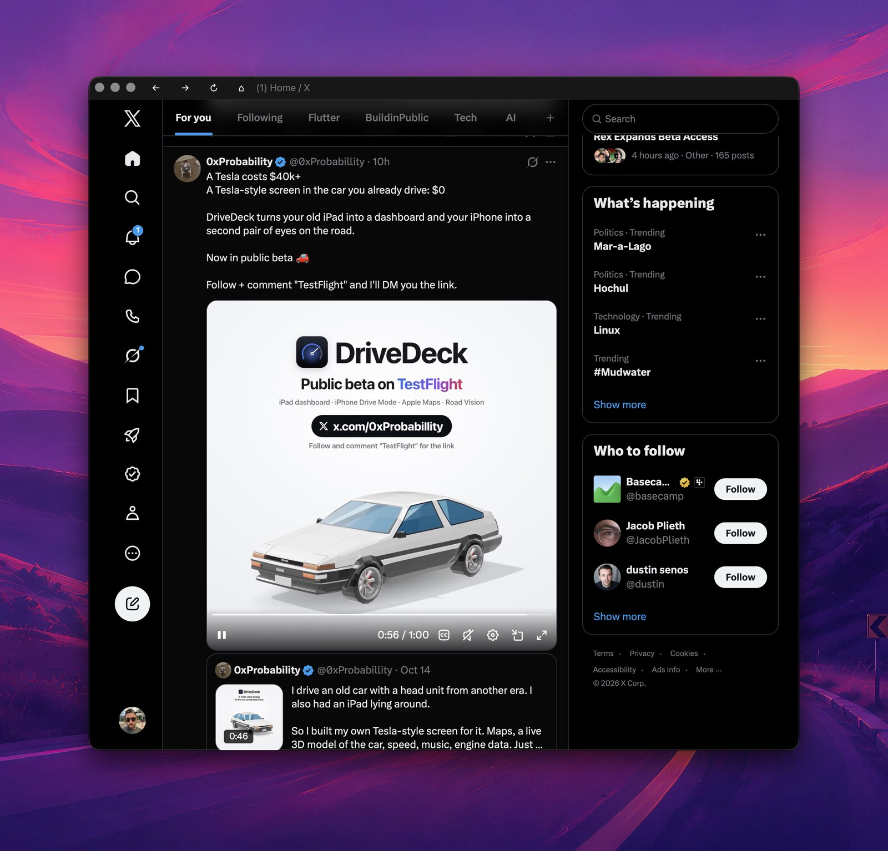

# quick-x

A native desktop shell for [x.com](https://x.com), built with [GPUI](https://www.gpui.rs) and the
[gpui-component](https://github.com/longbridge/gpui-component) `WebView` (wry / WKWebView).



## Install

macOS only. Needs a Rust toolchain.

```bash
make install     # builds and installs ~/Applications/Quick X.app
make uninstall   # removes it
```

Use `make install APP_DIR=/Applications` to install somewhere else.

## Toggle it with a hotkey (kiwi)

[kiwi](https://github.com/cesarferreira/kiwi) can show and hide Quick X with one key. Install the app first (`make install`), then add a binding to `~/.config/kiwi/config.toml`:

```toml
[bindings]
"hyper+x" = { app = "com.cesarferreira.quick-x", behavior = "toggle" }
```

`hyper` is the modifier you define in kiwi's `[hyper]` section (for example Caps Lock). Press the key once to open or focus Quick X. Press it again while Quick X is in front to hide it.

- Use the bundle ID, not the name `Quick X`. kiwi's toggle looks up the running process, and macOS lists it as `quick-x`, so a name lookup never finds it.
- kiwi reloads the config automatically. The first time it hides the app, macOS asks to let kiwi control System Events; allow it.

## Develop

```bash
make run         # cargo run --release
make test
make lint
make icon        # regenerate assets/AppIcon.icns from assets/icon.svg (needs rsvg-convert)
```

Set `QUICK_X_DEBUG=1` to log page loads, popups and new-window requests.

## Features

- GPUI title bar with back, forward, reload and home buttons, plus the page title
- Shortcuts: `⌘[` back, `⌘]` forward, `⌘R` reload, `⌘⇧H` home, `⌘Q` quit
- Native Edit menu, so copy and paste work inside the page
- Login persists between launches (WebKit data store in `~/Library/WebKit/com.cesarferreira.quick-x` for the app bundle, or `~/Library/WebKit/quick-x` with `cargo run`)
- "Sign in with Google/Apple" opens in a separate popup window, like a normal browser. The popup closes once x.com loads a signed-in page.
- Other links that open a new window load in the app if they point to x.com or twitter.com; all other web links open in your default browser

## Stack

| Crate | Version |
| --- | --- |
| `gpui` | 0.2.2 |
| `gpui-component` (`webview` feature) | 0.5.1 |
| `lb-wry` | 0.53.3 |

These versions are pinned on purpose: `gpui-component`'s `WebView` only accepts this exact `wry` type.
